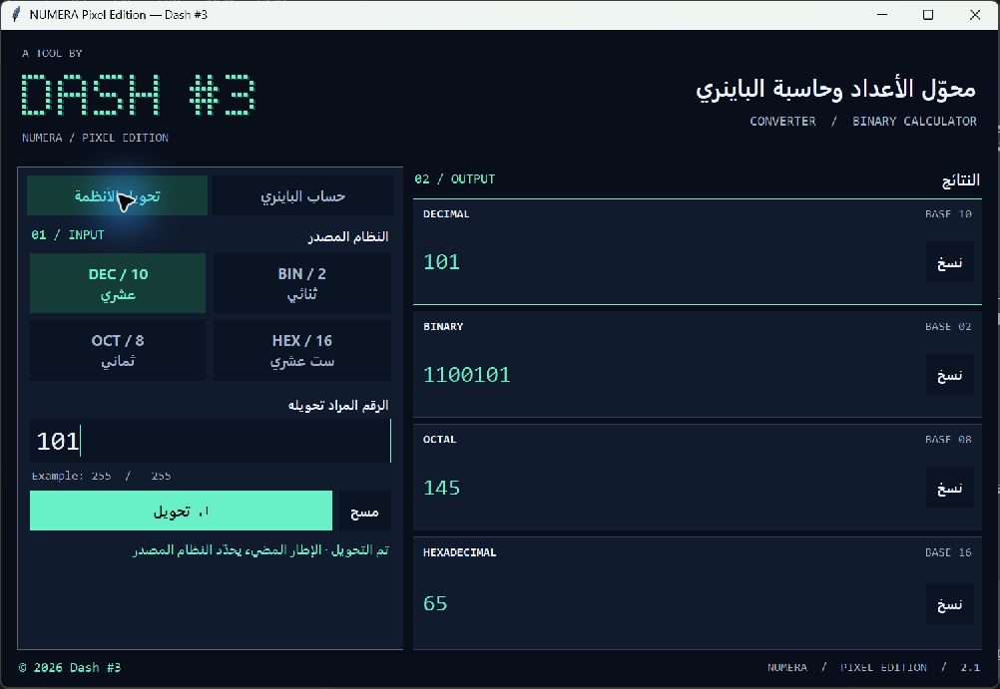
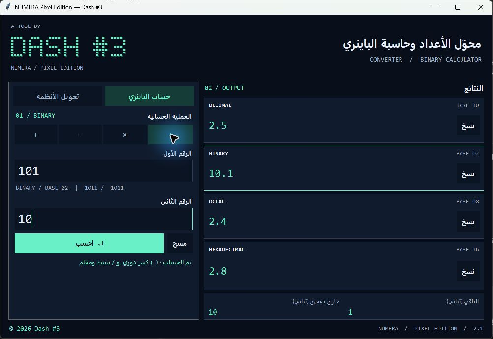

# NUMERA Pixel Edition 2.1

محوّل أنظمة عددية وحاسبة باينري بواجهة رسومية عربية، وشعار نقطي يحمل اسم **Dash #3**. يحوّل الأعداد الصحيحة بين العشري والثنائي والثماني والست عشري، وينفّذ العمليات الحسابية على رقمين ثنائيين، ويعرض النتائج في الأنظمة الأربعة.

A pixel-style number system converter and binary calculator with an Arabic desktop interface, built with Python and Tkinter. Created by **Dash #3**. See the **English** section below for setup and usage.





## المميزات

- واجهة داكنة بألوان هادئة وأزرار واضحة وتصميم بكسل.
- التحويل بين **Decimal (10)** و**Binary (2)** و**Octal (8)** و**Hexadecimal (16)**.
- وضع للحساب الثنائي يدعم **الجمع والطرح والضرب والقسمة** على عددين صحيحين.
- قسمة حقيقية تحفظ الكسر، مع عرض خارج القسمة الصحيح والباقي بالباينري أيضًا.
- دعم الأعداد السالبة، والأرقام العربية مثل `٢٥٥` والفارسية مثل `۲۵۵`، وحروف Hex الكبيرة والصغيرة.
- تمييز النظام المصدر بإطار مضيء حول نتيجته.
- زر لنسخ القيمة الكاملة لكل نتيجة، بما فيها الأرقام الطويلة.
- رسائل خطأ داخل النافذة مع الاحتفاظ بالرقم لتعديله.
- مسح النتائج السابقة وتعطيل نسخها عند تغيير أي رقم أو النظام أو العملية أو الوضع.
- تعمل باستخدام مكتبات Python الأساسية، دون مكتبات خارجية أو ملفات خطوط إضافية.

## المتطلبات

- **Python 3.8 أو أحدث**.
- **Tkinter**؛ يأتي عادةً مع Python، ويجب أن يكون متوفرًا في نسختك.
- بيئة سطح مكتب لعرض النافذة.

## التشغيل

افتح الطرفية في المجلد الذي يحتوي على `numera.py`، ثم شغّل:

```bash
python numera.py
```

## الاستخدام

### تحويل الأنظمة

1. اختر وضع **تحويل الأنظمة**، ثم النظام المصدر من الأزرار الأربعة.
2. أدخل عددًا صحيحًا، مثل `255` بالعشري أو `FF` بالست عشري.
3. اضغط **تحويل** لعرض النتائج في الأنظمة الأربعة.
4. اضغط **نسخ** بجانب النتيجة المطلوبة، أو **مسح** لبدء إدخال جديد.

حقل الرقم والنتائج يُعرضان من اليسار إلى اليمين لسهولة قراءة الأعداد. يمكن تحديد النص داخل حقول النتائج؛ وزر **نسخ** ينسخ القيمة كاملة حتى إذا تجاوزت المساحة الظاهرة.

### الحساب بالباينري

1. اختر وضع **حساب الباينري** داخل الواجهة.
2. اختر العملية: **جمع (+)** أو **طرح (−)** أو **ضرب (×)** أو **قسمة (÷)**.
3. أدخل العدد الأول والعدد الثاني بالثنائي، باستخدام `0` و`1`؛ يمكن استخدام إشارة سالب أو موجب، والأرقام العربية مثل `١٠١` مقبولة أيضًا.
4. اضغط **احسب**. تظهر النتيجة بالثنائي والعشري والثماني والست عشري.

| العملية بالباينري | النتيجة بالباينري |
| --- | --- |
| `101 + 11` | `1000` |
| `101 - 11` | `10` |
| `101 × 11` | `1111` |
| `101 ÷ 10` | `10.1` |

في القسمة فقط، يظهر **خارج القسمة الصحيح** و**الباقي** بالباينري. في مثال `101 ÷ 10`، الخارج الصحيح هو `10` والباقي `1`، بينما النتيجة الحقيقية هي `10.1`. عند وجود إشارة سالبة، يُقتطع الخارج الصحيح نحو الصفر، ويُحسب الباقي بالعلاقة `r = a - b × q`.

الكسور الدورية تُعرض بين أقواس؛ مثل `1 ÷ 11 = 0.(01)` بالباينري، حيث يتكرر الجزء `01`. إذا احتاج العرض إلى أكثر من 64 خانة قبل اكتمال الكسر أو اكتشاف دورته، تُعرض النتيجة في صورة **بسط/مقام** بالنظام المطلوب، دون تقريب. لا تُقبل القسمة على صفر، وتظهر رسالة توضح الخطأ مع الاحتفاظ بالمدخلات لتصحيحها.

## اختصارات لوحة المفاتيح

| المفتاح | الوظيفة |
| --- | --- |
| `Enter` | تنفيذ التحويل أو الحساب حسب الوضع؛ وإذا كان التركيز على زر، ينفّذ وظيفة ذلك الزر |
| `Escape` | مسح الحقلين والنتائج والعودة إلى حقل الرقم الأول |
| `Ctrl + L` | الانتقال إلى حقل الرقم الأول وتحديد محتواه |
| `Tab` | الانتقال بين عناصر الواجهة |
| `Space` | تفعيل الزر الذي عليه التركيز |
| `Ctrl + A` | تحديد النص كاملًا داخل حقل الرقم أو النتيجة |

## رفع المشروع إلى GitHub من الموقع

1. سجّل الدخول إلى حسابك على GitHub وأنشئ مستودعًا جديدًا باسم مثل `numera-pixel-edition`.
2. استخدم ملف `README.md` المرفق مع المشروع عند تجهيز المستودع.
3. إذا كانت الملفات داخل ZIP، فك الضغط أولًا، ثم ارفع محتويات مجلد المشروع.
4. افتح صفحة المستودع واختر رفع ملفات موجودة؛ في المستودع الذي يحتوي ملفات، ستجد الخيار ضمن **Add file → Upload files**.
5. اختر ملفات المشروع، ومنها `numera.py` و`README.md` و`preview.png` و`binary-preview.png`. ضع الصورتين في المجلد نفسه الذي يحتوي ملف README لتظهر المعاينة.
6. اكتب وصفًا قصيرًا للتغييرات، مثل `Add NUMERA Pixel Edition`، ثم أكمل تأكيد رفع الملفات وحفظها.
7. افتح الصفحة الرئيسية للمستودع وتأكد من ظهور الشرح والصورة وملف البرنامج.

يمكن الرجوع إلى [دليل GitHub الرسمي لرفع الملفات](https://docs.github.com/en/repositories/working-with-files/managing-files/adding-a-file-to-a-repository) لتفاصيل خطوات الموقع.

## English

### Features

- Convert signed integers between decimal, binary, octal, and hexadecimal.
- Add, subtract, multiply, or divide two binary integers.
- View results in all four bases and copy each complete value.
- Exact division: `101 / 10` produces `10.1` in binary and `2.5` in decimal.
- Division also shows an integer quotient and remainder in binary. The quotient is truncated toward zero, and `remainder = dividend - divisor * quotient`.
- Recurring digits appear in parentheses: `1 / 11` produces `0.(01)` in binary. When a fractional expansion needs more than 64 digits before it terminates or its cycle is found, the app displays an exact numerator/denominator in the selected base instead of rounding.
- Supports negative values, Arabic and Persian decimal digits, and uppercase or lowercase hexadecimal input in converter mode.
- Shows input errors inside the window, rejects division by zero, and clears stale results when an input, operation, or mode changes.

### Requirements and setup

Use **Python 3.8+ with Tkinter** in a desktop environment. No third-party Python packages or external font files are required.

Run from the project folder:

```bash
python numera.py
```

### Usage

The application labels are in Arabic:

1. Choose **تحويل الأنظمة** (base conversion) or **حساب الباينري** (binary arithmetic).
2. For conversion, select the source base, enter an integer, and click **تحويل** (convert).
3. For binary arithmetic, select `+`, `−`, `×`, or `÷`, enter two binary integers, and click **احسب** (calculate).
4. Click **نسخ** (copy) next to a result, or **مسح** (clear) to reset the inputs and results.

**Keyboard:** Enter runs the current action or invokes the focused button; Escape clears both inputs; Ctrl+L focuses and selects the first input; Tab moves focus; Space activates a focused button; Ctrl+A selects all text in an input or result field.

## الحقوق / Copyright

**© 2026 Dash #3 — جميع الحقوق محفوظة.**

تظهر الحقوق في الواجهة وفي الملف البرمجي.

Copyright (c) 2026 Dash #3. All rights reserved.
